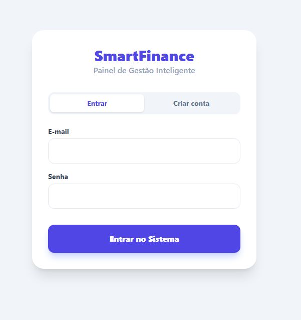
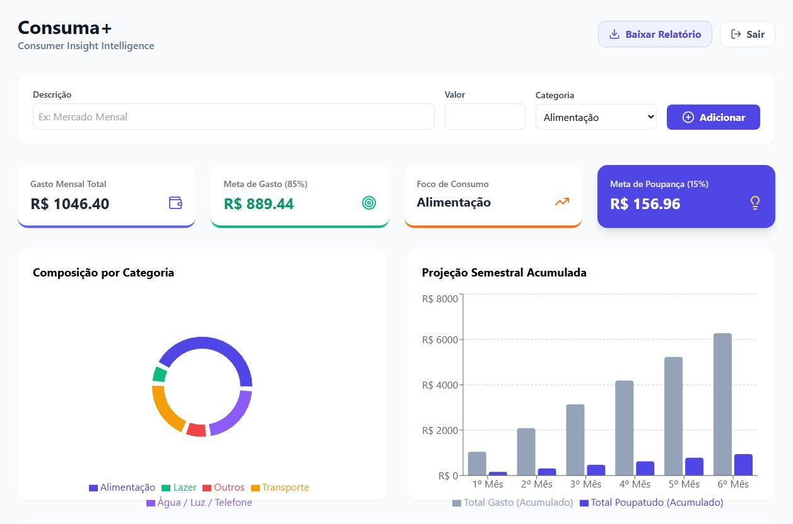
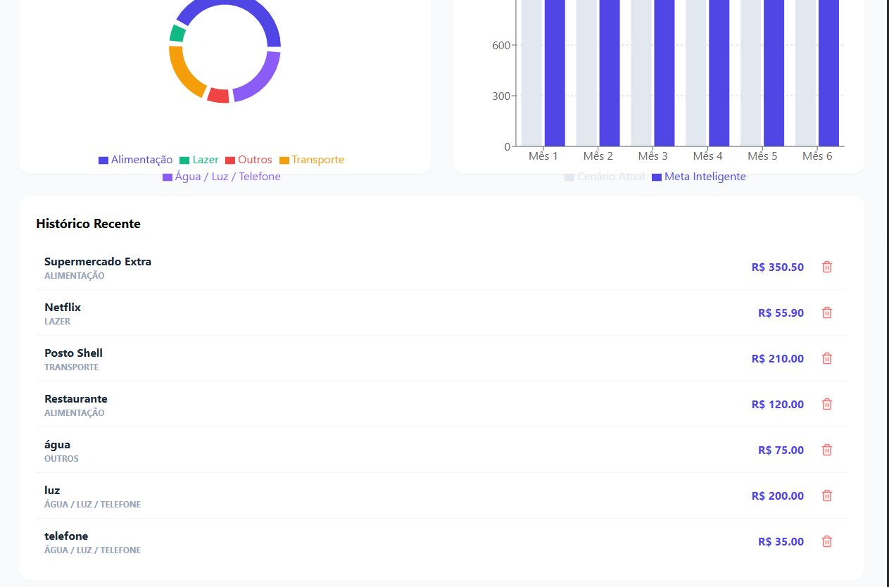
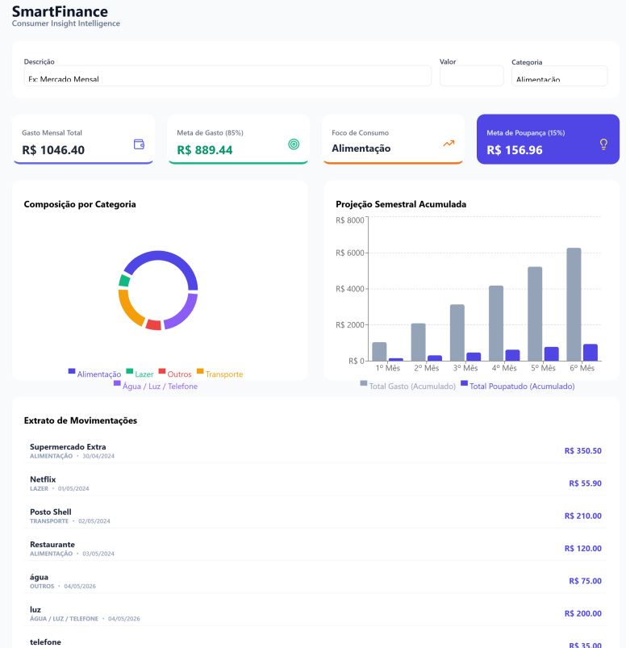
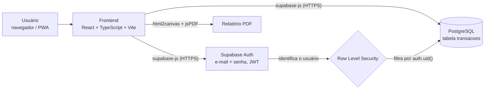

# SmartFinance | Consumer Insight Intelligence

O **SmartFinance** é uma plataforma de inteligência financeira desenvolvida para transformar a gestão de gastos pessoais em uma experiência analítica e estratégica. O projeto foca em converter dados brutos de transações em insights acionáveis, auxiliando usuários a identificar padrões de consumo e estabelecer metas de economia inteligentes.

## 📸 Demonstração do Sistema

### Tela de Login:


*Interface de acesso segura integrada com Context API para gerenciamento de sessão.*

### Dashboard Principal

*Painel com saldo de gastos, identificação de foco de consumo e gráfico de metas inteligentes.*

### Histórico e Composição de Gastos

*Visualização detalhada do histórico de transações e gráfico de pizza por categoria.*

### Relatório em PDF

*Relatório em PDF.*
---
## 🚀 Sobre o Projeto

O SmartFinance não é apenas um dashboard de visualização; é um ecossistema de Business Intelligence desenhado para oferecer clareza e previsibilidade financeira através de uma interface intuitiva e robusta.

### 🛠️ Tecnologias Utilizadas

*   **Frontend**: React.js com TypeScript.
*   **Ferramenta de Build**: Vite (garantindo alta performance no desenvolvimento).
*   **Estilização**: Tailwind CSS para um design moderno e responsivo.
*   **Visualização de Dados**: Recharts para criação de gráficos de composição (Pizza) e projeções (Barras).
*   **Exportação de Dados**: html2canvas e jsPDF para geração de relatórios em PDF.
*   **Ícones**: Lucide React.
*   **Backend & Persistência**: Supabase (PostgreSQL + Autenticação real de usuários).
*   **Gestão de Estado**: Context API para gerenciamento de autenticação global.
*   **PWA**: instalável como aplicativo (desktop/celular) e com carregamento offline do app, via manifest + service worker gerados pelo `vite-plugin-pwa` (Workbox).

## 🏗️ Arquitetura

O SmartFinance é uma aplicação **fullstack em arquitetura BaaS** (Backend as a Service): o frontend React conversa diretamente com o Supabase, que fornece banco de dados, autenticação e regras de segurança — sem necessidade de manter um servidor próprio.



**Como as camadas se conectam**

| Camada | Responsabilidade | Onde está no código |
|---|---|---|
| **Frontend** | Interface, gráficos, validação de formulários (React Hook Form + Zod), projeções de economia e geração de PDF | `src/pages`, `src/components`, `src/App.tsx` |
| **Autenticação** | Cadastro, login e sessão (JWT) via Supabase Auth; estado global com Context API | `src/context/AuthContext.tsx` |
| **Banco de dados** | PostgreSQL com a tabela `transacoes`, índice por usuário e `user_id` preenchido automaticamente com `auth.uid()` | `supabase/schema.sql` |
| **Segurança** | Row Level Security: 4 políticas (select, insert, update, delete) garantem que cada usuário só acesse as próprias transações, mesmo que a chave `anon` seja pública | `supabase/schema.sql` |
| **Integração** | Cliente Supabase configurado por variáveis de ambiente | `src/lib/supabaseClient.ts` |

**Por que BaaS?** Para um app de gestão pessoal, o Supabase entrega auth, banco relacional e isolamento por usuário com menos código e menos infraestrutura para manter. A segurança fica no próprio banco (RLS), e não apenas no frontend.

## 📊 Funcionalidades Principais

*   **Autenticação Real Multiusuário**: Cada pessoa cria sua própria conta (e-mail/senha) via Supabase Auth. Ninguém precisa da senha de admin para testar — e os dados de cada usuário ficam isolados dos demais (Row Level Security no banco).
*   **Instalável (PWA)**: o navegador oferece a opção "Instalar app"/"Adicionar à tela de início"; depois de instalado uma vez, o app abre offline (a interface carrega normalmente; leituras recentes do Supabase ficam em cache e novos lançamentos exigem conexão).
*   **Relatórios em PDF**: Exportação instantânea do dashboard completo (gráficos e histórico) para arquivos PDF, facilitando o compartilhamento da análise financeira.
*   **Dashboard Inteligente**: Painel visual com saldo total de gastos e identificação do foco principal de consumo.
*   **Metas de Economia**: Algoritmo que projeta cenários de economia (15%) baseados no comportamento financeiro atual.
*   **Projeção Semestral**: Algoritmo que projeta o acúmulo de capital para os próximos meses, permitindo o planejamento de grandes compras ou investimentos.
*   **Gestão de Transações**: Sistema para controle rigoroso de despesas com geração de IDs únicos via UUID.

## 🛠️ Configuração do Ambiente

### Pré-requisitos
*   Node.js instalado.
*   Gerenciador de pacotes (npm ou yarn).
*   Uma conta gratuita no [Supabase](https://supabase.com).

### Passo a Passo

1.  **Clone o repositório**:
    ```bash
    git clone [https://github.com/Li-code1/smart-finance.git](https://github.com/Li-code1/smart-finance.git)
    ```

2.  **Instale as dependências**:
    ```bash
    npm install
    ```

3.  **Crie um projeto no Supabase**:
    *   Acesse [supabase.com](https://supabase.com), crie uma conta e clique em "New project" (plano gratuito).
    *   Dentro do projeto, abra **SQL Editor** > **New query**, cole o conteúdo do arquivo `supabase/schema.sql` deste repositório e clique em **Run**. Isso cria a tabela `transacoes` e as regras de segurança (cada usuário só acessa seus próprios dados).
    *   Vá em **Project Settings > API** e copie a **Project URL** e a chave **anon public**.

4.  **Configure as variáveis de ambiente**:
    Copie `.env.example` para `.env` e cole os valores obtidos no passo anterior:
    ```bash
    cp .env.example .env
    ```
    ```env
    VITE_SUPABASE_URL=https://SEU-PROJETO.supabase.co
    VITE_SUPABASE_ANON_KEY=sua-chave-anon-public-aqui
    ```

5.  **Inicie o Frontend**:
    ```bash
    npm run dev
    ```

> **Nota sobre PWA**: o manifest e o service worker são gerados no build pelo `vite-plugin-pwa` (configurado em `vite.config.ts`). As leituras do Supabase usam a estratégia `NetworkFirst`, com cache de 24h para consulta offline. O arquivo `.npmrc` com `legacy-peer-deps=true` evita conflitos de peer dependencies no ecossistema Vite.

## 🔑 Acesso ao Sistema
Cada pessoa pode criar sua própria conta gratuitamente pela própria tela de login (aba "Criar conta"), com e-mail e senha à sua escolha — não é mais necessário nenhum login de administrador para testar o sistema.

*Nota: por padrão o Supabase exige confirmação por e-mail antes do primeiro login. Se preferir liberar o acesso imediato durante testes, desative "Confirm email" em **Authentication > Providers > Email** no painel do Supabase.*

## 📈 Trajetória Técnica

O desenvolvimento do SmartFinance faz parte de um projeto de conclusão do curso de Front-End da AdaTech.

---

```

```
